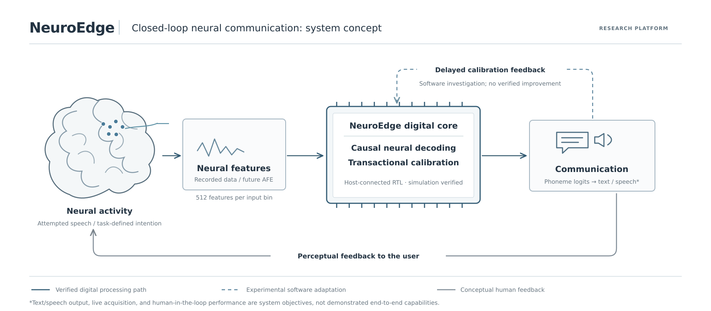

# NeuroEdge

**Causal neural decoding and memory-centric digital hardware for assistive communication**
*Experimental research platform · Work in progress*



*Figure 1. Conceptual NeuroEdge platform. The host-connected neural decoder and transactional calibration memory have been verified in RTL simulation. Delayed adaptation has been evaluated in software; user-facing communication and biological acquisition remain system goals. The figure does not represent fabricated or implanted hardware.*

## Overview

NeuroEdge investigates how recorded neural activity can be converted into **intended communication** using causal decoding, fixed-point digital hardware, and controlled memory updates. The initial application is **attempted-speech decoding from intracortical recordings**, not unrestricted recognition of private thoughts.

The repository connects a neural-signal processing workflow with a hardware implementation: recorded feature vectors enter a trial-aware host interface; a synchronous INT8 network produces phoneme-class scores; a transactional calibration bank supports safe input corrections. A separate software workflow investigates whether delayed feedback can improve future trials. Near-memory and compute-in-memory alternatives are research tracks, **not replacements for the verified decoder**.

## Implemented digital system

| Interface or component | Current implementation |
|---|---|
| Neural input | 512 signed INT8 features per bin (nominal 20 ms); recorded data are preprocessed outside the RTL |
| Host interface | Transaction-based register adapter, model loading/sealing, four-entry input/output FIFOs, status/fault registers, interrupt signaling |
| Calibration | 512 signed INT16 offsets in the input's Q4 integer units; staged writes, authorization, abort, and no mid-bin commit |
| Neural decoder | Causal, synchronous INT8 network with **44,224 weights** and fixed-point bias/shift operations |
| Neural output | 41 signed INT16 CTC-class logits per output step; output produced every four input bins |
| Software transport | 540-byte C/Python feature packet, trial and timestamp fields, CRC32, sequencing and recovery |
| Feedback research | Post-trial bounded software proposals; calibration changes only for subsequent processing when authorized |

The adapter is a research synchronous register interface. It is **not** a deployed AXI/APB peripheral, physical neural recorder, or complete speech synthesizer. The digital decoder currently produces phoneme logits; converting these into dependable text or audio is a separate system-level task.

See [architecture](docs/architecture.md), [numerical specification](docs/numerics.md), and [host-interface contract](docs/host_to_rtl_integration.md).

## Verification and evidence

The following results were observed in the project's Ubuntu WSL simulation and software test logs. They are not FPGA, post-layout ASIC, or clinical measurements.

| Test | Observed result |
|---|---|
| Full host-to-RTL regression | **PASS**; all 328 expected logits matched over 32 bins (16,384 input features) |
| Model loading | Complete decoder parameters loaded through the host register interface |
| Calibration safety | Mid-bin authorization rejected: **1 reject, 0 accepted writes** in the targeted test |
| Authorized calibration | Committed test offset matched the Python oracle across 328 logits; 8 logits changed in the synthetic fixture |
| Flow control | Real decoder output backpressure exercised for 20 blocked cycles; subsequent results matched |
| Integrated latency | Worst host-test bin: **90,201 simulated cycles**; 3.608 ms at the **assumed** 25 MHz clock |
| Reproducibility | `NEUROEDGE_COMPLETE_PRIVATE_SYSTEM_PASS` and `PUBLICATION_SOURCE_AUDIT_PASS` observed in WSL |

### Recorded-neural evaluation

A four-trial replay using the local August 2023 attempted-speech validation recordings included **3,123 input bins** and **32,103 scalar logits**.

| Calibration strategy | Greedy phoneme error rate | Committed writes |
|---|---:|---:|
| Frozen | 59.48% | 0 |
| Sham | 60.34% | 3 |
| Delayed supervised | 59.48% | 0 |

The supervised policy accepted **no updates** and showed **no improvement** in this experiment. The result establishes a functioning recorded-data replay and a negative adaptation finding, not improved speech restoration. A different synthetic feedback fixture demonstrates that delayed memory changes are executable, but cannot substantiate neural-decoding efficacy.

[Verification methods and limitations](docs/evidence_and_limitations.md) · [Feedback diagnostics](docs/feedback_diagnostics.md)

## Reproduce the public synthetic tests

Requirements: Ubuntu (WSL supported), Python 3.10+, Icarus Verilog, a C compiler, and the dependencies in `pyproject.toml`.

```bash
sudo apt-get update
sudo apt-get install -y python3-venv iverilog build-essential
python3 -m venv .venv
source .venv/bin/activate
python -m pip install -e '.[dev]'

make PYTHON=python private-acceptance
NEUROEDGE_PYTHON=python bash scripts/verify_complete_system.sh
python scripts/check_publication.py
```

The synthetic regressions do not require participant recordings or trained checkpoints. The neural-data replay and trained-model exports require separately obtained, locally held files; these are not distributed in this repository.

## Repository map

| Location | Responsibility |
|---|---|
| `neuroedge/speech/` | Causal model, CTC, quantization, bit-exact integer reference |
| `neuroedge/system/` | Feature framing, trial receiver, offline streaming replay |
| `neuroedge/control/` | Feedback policy experiments and transactional software reference |
| `neuroedge/memory/` | Banked projection and numerical memory-compute experiments |
| `rtl/speech/`, `rtl/control/`, `rtl/soc/` | Decoder, calibration bank, integrated pipeline, host adapter |
| `rtl/memory/` | Independently verified signed INT8 near-memory dot-product experiment |
| `firmware/` | C register driver and feature-packet codec |
| `verification/`, `scripts/` | RTL/Python/C tests, synthetic fixtures, and evaluation tools |
| `research/`, `analog/`, `physical/`, `memory/` | Neural, analog, physical-design, and emerging-memory investigations |
| `docs/` | Interfaces, methods, design limitations, evidence and references |
| `website/` | Research presentation and interactive demonstrations (optional GitHub Pages deployment) |

## Research directions and boundaries

NeuroEdge is being developed toward a **consent-based, closed-loop neural communication system**. Two feedback mechanisms are distinguished: (1) a person perceives the output and adjusts subsequent behavior, and (2) an authorized software controller uses permitted, delayed supervision to propose future calibration changes. Neither an effective human-in-the-loop speech interface nor autonomously beneficial real-neural adaptation has been demonstrated here.

Current active directions include stronger cross-session causal decoding, explicit output release/abstention, decoupled decoder-state reset and persistent calibration, a complete banked near-memory projection, and quantitative SRAM-CIM/RRAM-CIM comparisons. Live electrode acquisition, analog front-end hardware, stimulation, fabricated silicon, and clinical validation are **outside the currently verified implementation**.

For complete experimental boundaries, see [system limits](docs/system_boundaries.md) and [research experiments](docs/research_experiments.md). This is research software and digital hardware, not a medical device or a system for decoding arbitrary thoughts.

## Citation and license

Citation metadata is in [`CITATION.cff`](CITATION.cff). The source license is in [`LICENSE`](LICENSE); publication of any code, figures, or model-derived materials remains subject to verification of authorship, third-party permissions, and applicable intellectual-property agreements.
